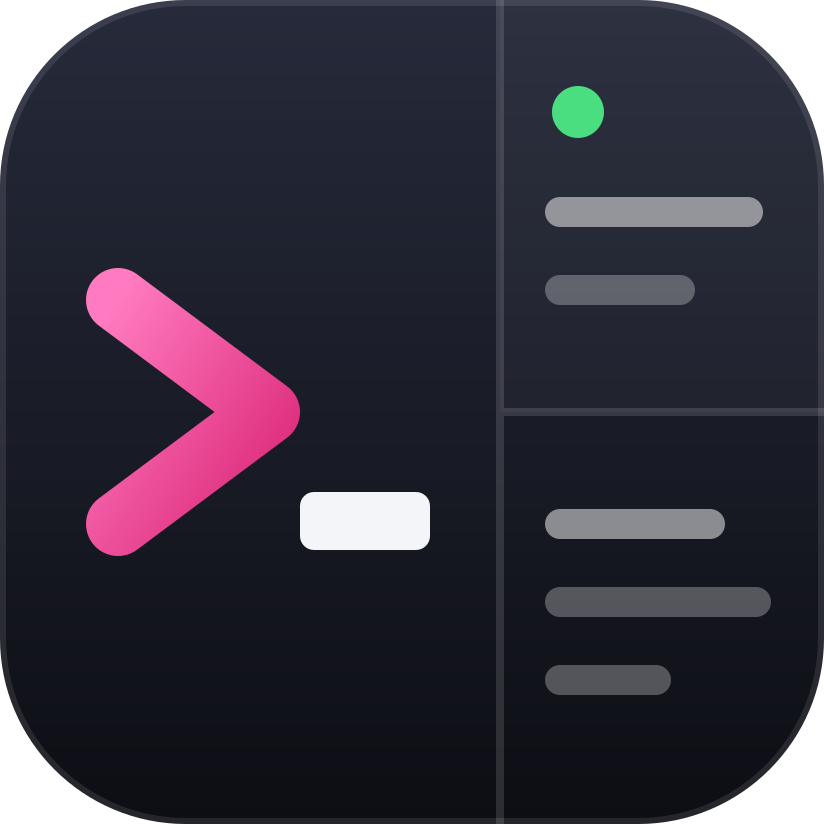
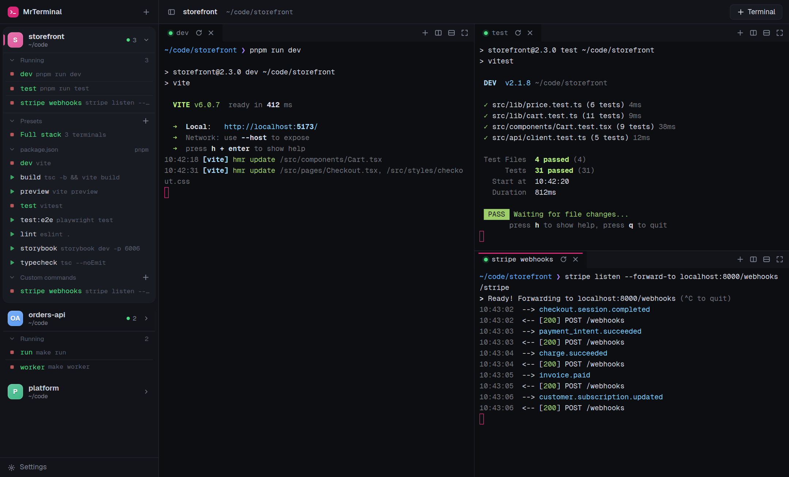
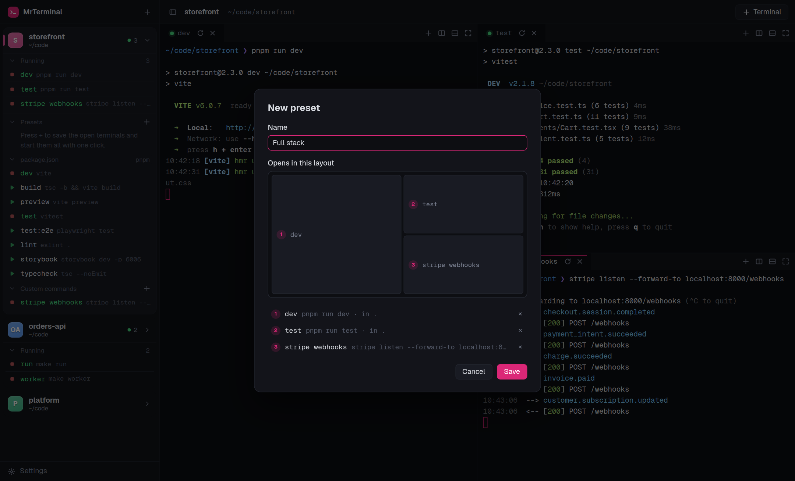
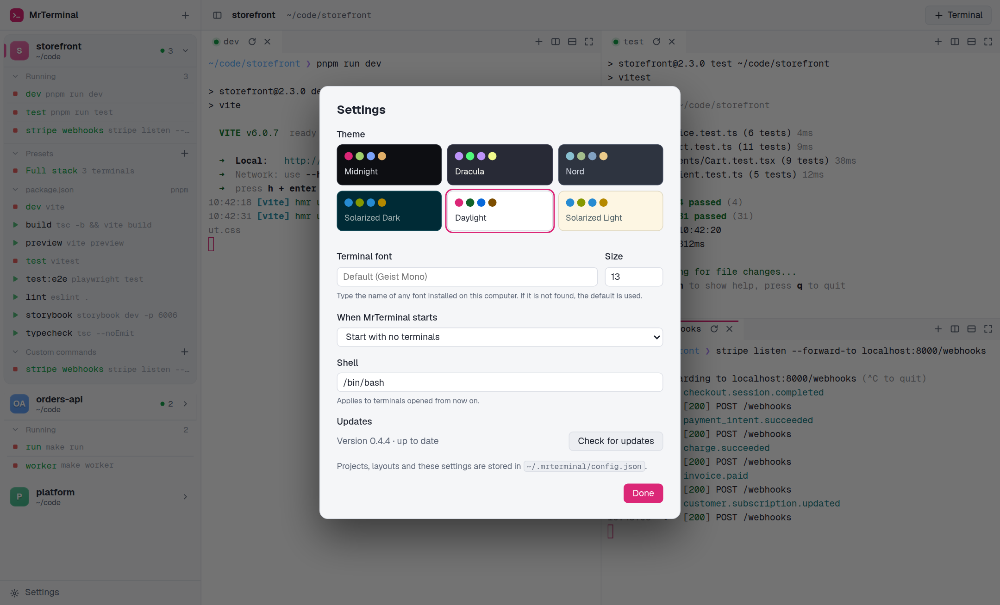

# MrTerminal

**One window for every terminal your projects need.** Add a repository and
every script it defines is one click away. Start the dev server, the tests and
the webhook listener together, see at a glance what is running, and get it all
back after a restart.



## Why

Working on a real project usually means four or five long-running commands:
a dev server, a test watcher, an API, a queue worker, a tunnel or webhook
listener. Usually across more than one repository. In a plain terminal that
turns into:

- **Tab archaeology.** A dozen tabs titled `node` or `zsh`, and the one you
  need is never the one you click.
- **Retyping the same commands every morning.** `cd` into each folder, recall
  whether it was `pnpm dev` or `make run`, and repeat after every reboot or
  crash.
- **Not knowing what is actually running.** Did the worker die? Is something
  still holding port 5173? Which project is that server from?
- **Remembering every repo's commands.** `package.json`, `Makefile`,
  `pyproject.toml`, `compose.yaml`: each project hides its commands somewhere
  different.

IDE terminals and multiplexers help with parts of this, but they either tie you
to one editor or ask you to write and maintain a config file. MrTerminal reads
the commands your projects already define and gives each one a button.

## What it does

- **Every script, one click away.** MrTerminal reads `package.json`,
  `Makefile`, `pyproject.toml`, `justfile`, `Procfile`, `compose.yaml`,
  `Cargo.toml`, `go.mod` and more, including sub-folders, and picks the right
  runner (`npm`, `pnpm`, `yarn`, `bun`, `uv`, `poetry`, `make`...). Green ▶
  starts a command, red ■ stops it.
- **Honest "running" status.** Green means a command is executing right now,
  as reported by your shell, not just "a tab is open". Every project card shows
  what is running inside it, even when folded, each with its own stop button.
- **Your real shell.** Each terminal is your own login shell (zsh, bash, fish)
  with your prompt, aliases and history. MrTerminal types the command for you,
  so Ctrl-C drops you back at a prompt exactly like in Terminal.app or iTerm.
- **Layouts you arrange by dragging.** Split, stack and resize terminals.
  Each project keeps its own layout, and its terminals keep running while you
  look at another project.
- **Presets.** Save a set of terminals and their arrangement ("Full stack")
  and start them all with one click tomorrow.
- **Sessions that survive restarts.** Quit and reopen: your projects, layouts
  and commands come back, and MrTerminal can start them again for you.
- **Your own commands too.** Add anything that is not in a script file
  (`stripe listen`, `docker compose logs -f`), give scripts friendlier names,
  and reopen a tab you closed by mistake with ⇧⌘T.



Six themes (Midnight, Dracula, Nord, Solarized Dark, Daylight, Solarized
Light) recolour the app and the terminals together, and you can use any
installed font.



## Install

Download the build for your system from the [Releases](../../releases) page:

- **macOS (Apple silicon and Intel):** `.dmg` (`arm64` or `x64`).
- **Windows 10/11 (x64):** `win-x64-setup.exe`. Run the installer. The app is unsigned; Windows may show a SmartScreen prompt.
- **Linux (x64):** `.AppImage` or `.deb`. Make the AppImage executable (`chmod +x MrTerminal-*.AppImage`) and run it, or install the Debian package with `sudo apt install ./MrTerminal-*.deb`. AppImages need FUSE 2 (or launch with `--appimage-extract-and-run`).

Windows uses PowerShell by default, with your profile and PSReadLine. PowerShell
and PowerShell 7 (`pwsh.exe`, selectable in Settings) report command status;
custom Windows shells without integration do not provide running status or
per-command exit codes.

Download the `.dmg` from the [Releases](../../releases) page (`arm64` for Apple
silicon, `x64` for Intel) and drag MrTerminal to Applications.

The app is not notarized by Apple yet, so macOS blocks the first launch. Clear
the download flag once and it opens normally:

```sh
xattr -cr /Applications/MrTerminal.app
```

### Updates

MrTerminal checks this repository's GitHub releases when it starts and every
few hours. On Windows and Linux, the update button opens the release page to
download and install the newer build. On macOS, when a newer version exists an **Update to x.y.z** button appears in
the top bar; clicking it downloads the update, verifies its checksum, replaces
the app and restarts it, and your terminals reopen. Settings shows the running
version and has a "Check for updates" button.

To publish a version: bump `version` in `package.json`, commit, then
`git tag v<version> && git push --tags`.

## Command line and coding agents: `mrt`

Everything you can click, `mrt` can do from a shell, and so can a coding
agent such as Claude Code. Choose **Shell → Install 'mrt' Command…** once,
then add the displayed directory to your PATH if needed. On Windows, add
`%USERPROFILE%\.mrterminal\bin` to your user Path in Environment Variables
and open a new terminal. Then:

```sh
mrt status                                   # what is open and what is running
mrt run dev                                  # start a script in its own terminal
mrt wait dev --match 'ready' --timeout 60    # until the server is up
mrt run test --wait                          # run tests: their output, their exit code
mrt read dev --lines 40                      # what a terminal printed
mrt send notes 'git status'                  # type into a terminal
mrt stop dev                                 # Ctrl-C
```

Nothing runs out of sight. Every terminal `mrt` opens or types into is a normal
tab in the window, brought on screen as it happens, so you see what an agent is
doing and can take over or press Ctrl-C at any time. Your keyboard stays where
you left it.

**Set it up with your agent.** Paste this into Claude Code, Codex, Cursor or any
coding agent:

```
Read https://kthilagarajan.github.io/mrterminal/setup.md and set up MrTerminal for me.
```

Or do it yourself: `mrt skill install` writes the skill to
`~/.agents/skills/mrt/`, the folder coding agents share, and links
`~/.claude/skills/mrt` to it for Claude Code. `mrt --help` lists every command.
Your projects, terminals, layouts and presets are stored in
`~/.mrterminal/config.json`, described by a JSON Schema (`mrt config schema`).

## Run from source

```sh
npm install
npm run dev        # develop with hot reload
npm run dist       # package for the current OS into dist/
```

Requires Node 22+. macOS and Windows use node-pty prebuilt binaries. Linux
needs Python 3, make and a C++ compiler (`sudo apt install python3 make g++`).

GitHub Actions builds all three platforms on pushes to main, pull requests and
manual runs; installers are available as run artifacts. A `v<version>` tag
publishes all platform downloads together after every build and check passes.
The tag must match `package.json`.

## How it works

**The sidebar is a list of project cards.** Add a folder with `+` or ⌘O. Click
a project to show its terminals on the right; click the one already shown to
unfold or fold it. Folded, a card lists only what is running in it right now.
Unfolded, it also lists everything it can run. Every heading inside a card
(Running, Presets, each script file, Custom commands) folds on a click. Each
project gets its own colour, used for its icon and its outline. Each project keeps its own
terminals and layout, and they keep running while you look at another one.

Hovering a project shows its buttons: stop everything running in it, re-read
its scripts from disk, and a menu to move it up or down, open its folder or
remove it. Drag a project to reorder; a blue line shows where it will land.

**Running** means a command is executing in that terminal right now. A
terminal waiting at its prompt is not running, whatever opened it. The count
beside a project, the green dots and the *Running* list at the top of its card
(each entry with its own stop button, the same as Ctrl-C) all follow that. MrTerminal learns it from
the shell itself (zsh, bash 4.4+ and fish 4 report when a command starts and
ends), so it also covers commands you type by hand.

**Scripts.** Read from the project and its sub-folders:

| File | Runs as |
| --- | --- |
| `package.json` scripts | `npm` / `pnpm` / `yarn` / `bun run <name>`, chosen from `packageManager` or the lockfile |
| `pyproject.toml` | entry points, poe, pdm, taskipy and hatch tasks, via `uv run` / `poetry run` when the project uses them |
| `manage.py`, `main.py`, `app.py`… | `python3 <file>` |
| `Makefile`, `justfile` | `make <target>`, `just <recipe>` |
| `Procfile` | the command itself |
| `compose.yaml` | `docker compose up` / `logs` / `down` |
| `Cargo.toml`, `go.mod`, `deno.json`, `composer.json` | the usual commands |

Click a script to run it. Click it again to jump to its terminal (or re-run it
if it stopped); ⌥-click starts a second copy. Scripts are re-read whenever the
window gets focus, or with the project's refresh button.

To give a script a friendlier name (say `UAT server` instead of `dev:uat`),
hover it and press the pencil, or double-click the title of its tab. The name
shows in both places and is remembered per project; the command itself is
untouched. Clear the name to go back to the original. If the script is later
renamed or removed in the project, the old name is simply dropped.

**Presets.** Several terminals in one click. Open the terminals you want
together, arrange them, then press `+` next to Presets. The dialog shows a
miniature of the window with numbered panes and the command behind each
number; remove the ones you do not want and save. Clicking the preset puts
those terminals in that arrangement: ones already open are kept and moved
into place, stopped ones are re-run, missing ones are started. The pencil on a
preset reopens the dialog to rename it, drop terminals, replace it with what
is open now, or delete it.

**Custom commands.** Anything that is not in a script file: press `+`, type
the command, and optionally give it a name and a folder to run in (relative to
the project, or absolute). They are saved per project, run like any other
script, and can be edited or deleted from the row.

**Terminals** (right). Drag a tab onto the edge of any pane to split that way,
or onto another tab bar to stack it as a tab. Each pane also has buttons for
new tab, split right, split down and maximize. Double-click a tab title to
rename it. A plain terminal is named after the folder it opens in.

Closed something by mistake? ⇧⌘T (or the arrow in the top bar) reopens the
last closed tab where it was and runs its command again; it also brings back
a project you just removed, with its presets and commands.

| | macOS | Linux / Windows |
| --- | --- | --- |
| New terminal | ⌘T | Ctrl+Shift+T |
| Split right / down | ⌘D / ⇧⌘D | Ctrl+Shift+D / Ctrl+Shift+E |
| Restart terminal | ⇧⌘R | Ctrl+Shift+R |
| Clear | ⌘K | Ctrl+Shift+K |
| Close terminal | ⌘W | Ctrl+Shift+W |
| Reopen closed tab or project | ⇧⌘T | Ctrl+Shift+Z |
| Toggle sidebar | ⌘B | Ctrl+B |

## Sessions

Projects, open terminals, layouts and settings live in
`~/.mrterminal/config.json`. On launch MrTerminal asks what to do with the
terminals from last time:

- **Resume and run commands**: same layout, every command started again.
- **Restore layout only**: same layout, each command typed at the prompt
  waiting for Enter.
- **Start fresh**.

Tick "always do this" to stop being asked; change it later in Settings (⌘,).

## Appearance

Settings (⌘,) has six themes (Midnight, Dracula, Nord, Solarized Dark,
Daylight, Solarized Light) that recolour the app and the terminals together,
and a terminal font field. The app uses Geist for its interface and Geist Mono
in terminals by default (both bundled); to change the terminal font, type the
name of any font installed on the machine
(for example a Nerd Font for prompt icons) and pick a size.

A project whose folder no longer exists is dropped from the list at startup.

Processes do not survive quitting the app: resuming starts them again, and
scrollback from the previous run is not kept.

## Code map

```
src/main/      Electron main process
  pty.ts         shell processes (node-pty)
  scripts.ts     script detection, with tests in scripts.test.ts
  config.ts      ~/.mrterminal/config.json
  updater.ts     over-the-air updates from GitHub releases
  control.ts     the socket the mrt command talks to
src/cli/       the mrt command-line tool
src/shared/    types and themes used by both sides
src/preload/   the API exposed to the UI
src/renderer/  React UI
  dock.ts        split/tab layout (dockview)
  terminals.ts   terminal views (xterm.js)
```

`npm test` runs the tests (script detection, shell integration, the mrt
protocol); `npm run typecheck` checks types.

## License

[MIT](LICENSE)
